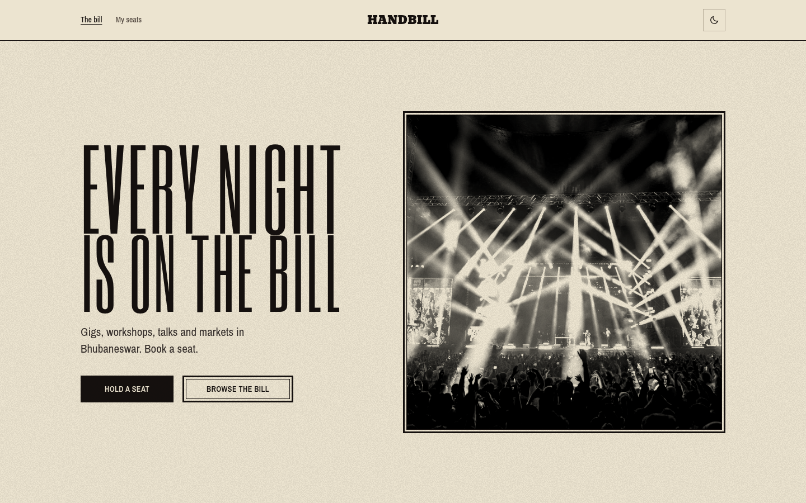
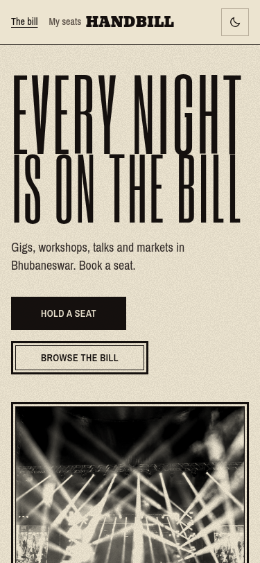

# Handbill

An event listing site for Bhubaneswar, made for the K Explore web designing task at KIIT.

Live link: https://renhiyama.github.io/handbill/



## About

Handbill is a one-page list of eight events in the city, plus a page for each one and a form to hold a seat. The design is based on printed event posters: condensed headline type, buff paper, black ink and one vermilion accent.

The events themselves are made up. I used real areas of Bhubaneswar (Patia, Old Town, Saheed Nagar, Master Canteen, Nayapalli, Unit 3, Chandrasekharpur) so the listings feel local.

## Features

- Eight events with date, time, venue, area, price and photo
- Search across titles, venues and areas
- Category filters (music, talks, food, art, sport, market, film)
- Detail page for each event with the running order and travel details
- Countdown to the next event
- Registration form with validation for name, email, phone and number of seats
- A reference code after booking, and a My seats page where bookings can be cancelled
- Bookings saved in `localStorage`, so they survive a reload on the same device
- Light and dark themes, remembered between visits
- Responsive layout down to 375px



## What is not real

There is no backend, no payment and no email. The form really does save the booking in the browser, and the confirmation says so. Clearing site data removes the bookings.

## Built with

- React 19
- Vite 7
- React Router 7
- Tailwind CSS 4 for the reset and utility classes
- Custom CSS for the page layout
- Six Caps, Bevan and Archivo Narrow from Google Fonts

## Running locally

```bash
bun install
bun run dev
```

Then open `http://localhost:5173/`.

To check the production build:

```bash
bun run build
bun run preview
```

## Deployment

The site is on GitHub Pages. The workflow in `.github/workflows/deploy.yml` builds with Bun and publishes `dist/` whenever `main` is updated. Pages is set to deploy from GitHub Actions.

The build uses `/handbill/` as its base path, because the repository is called `handbill`. If the repository is renamed, change `REPO` in `vite.config.js` to match.

GitHub Pages does not handle client-side routes on its own, so `public/404.html` catches deep links like `/handbill/event/night-shift`, stores the path in `sessionStorage`, and sends the visitor back into the app.

## Folders

```
src/
  components/     header, footer, cards, countdown, form, seat list
  data/           the eight events
  hooks/          theme and countdown hooks
  lib/            formatting, image paths, localStorage store
  pages/          home, event detail, my seats, credits, not found
  styles/         CSS variables and base rules
public/
  images/         photos at two sizes
  404.html        redirect for GitHub Pages
```

## Photos

The photos are from Wikimedia Commons under free licences. The credits page lists each photographer, licence and source file, and is linked from the footer.
